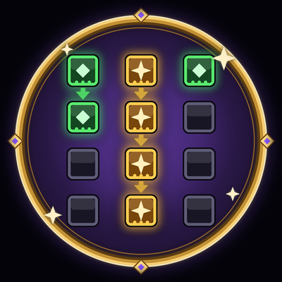
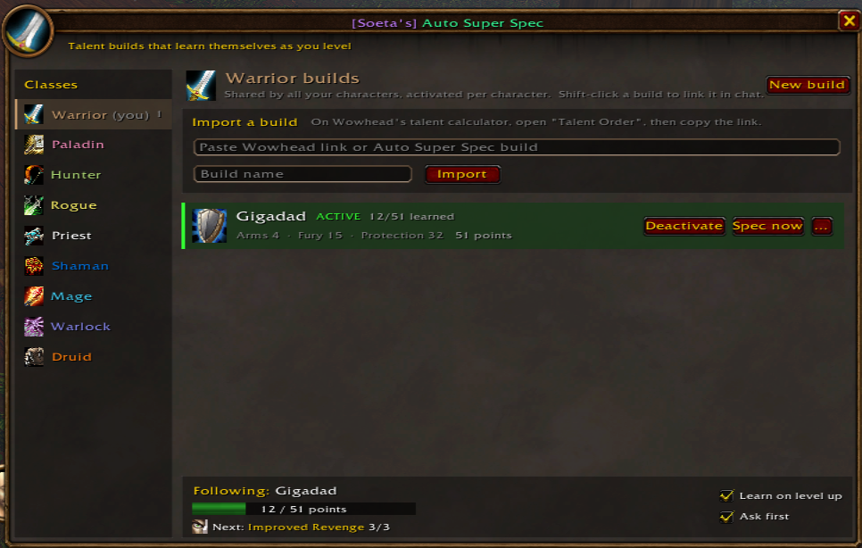
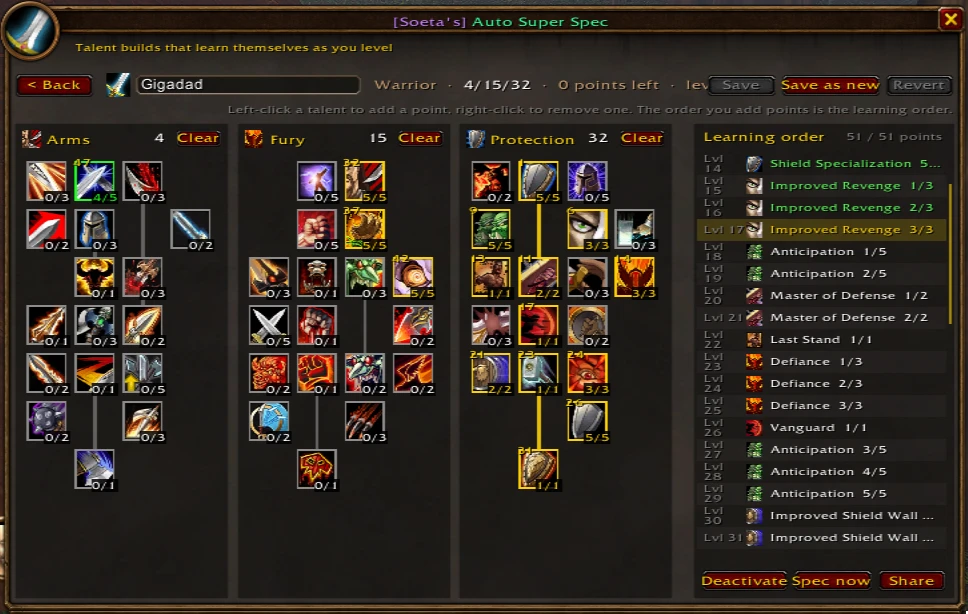

# Auto Super Spec

*by Soeta*

Import talent builds from Wowhead, pick the one you're leveling, and Auto Super Spec learns its talents in order every time you ding. It's made for WoW: Forever (interface 16001) and also works on classic-style clients.

## Install

**Easiest:** download `AutoSuperSpec.zip` from the [latest release](https://github.com/aabotnes/AutoSuperSpec/releases/latest) and unzip it into your `Interface\AddOns` folder.

**From the code:** click **Code → Download ZIP**, unzip it, rename the folder `AutoSuperSpec-main` to `AutoSuperSpec`, and move it into `Interface\AddOns`.

Either way you should end up with `Interface\AddOns\AutoSuperSpec\AutoSuperSpec.toc`. The folder must be named exactly `AutoSuperSpec`, or the game won't load it. Restart the game and make sure **Auto Super Spec** is ticked in the AddOns list on the character screen.

## Your builds (`/ass` or the minimap button)

This is the page you see when you open Auto Super Spec. In the screenshot, a Warrior has one build, **Gigadad**, which is active and 12 of its 51 points are learned.

- **Classes (left).** Your class is selected when the window opens and is marked *(you)*. The number next to a class is how many builds you have saved for it. Click another class to see, import or share its builds.
- **Import a build (top).** Paste a Wowhead talent calculator link on the first line, type a name on the second, and press **Import**. If the link is for another class, the build is saved under that class.
  On Wowhead, open the **Talent Order** section before you copy the link, so the link includes the order you spent points in.
- **New build (top right).** Make a build from scratch in the talent calculator.
- **Your builds (middle).** Each build shows its points per tree (here *Arms 4 · Fury 15 · Protection 32*) and its total.
  - **Click a build** to open it in the talent calculator. **Shift-click** it to link it in the chat message you're typing.
  - **Activate / Deactivate** sets the build this character levels with. Only one is active at a time; the active build is highlighted in green with how many of its points you've learned.
  - **Spec now** spends your free points on the build right away. If your current talents don't match the build, it offers to reset them and spec from scratch, when the game allows it. Otherwise reset at your class trainer first.
  - **...** (or right-click) opens **View / edit talents**, **Share...**, **Rename** and **Delete**.
- **Following (bottom).** The build this character follows, a progress bar, and the next talent it will learn (here *Improved Revenge 3/3*). Two options:
  - **Learn on level up**: learn the next talents automatically when you ding.
  - **Ask first**: show a popup with a **Learn** button instead of learning right away.

## Talent calculator

Click a build, or **New build**, to open it in the talent calculator. It opens inside the same window; **< Back** takes you back to your builds.

**Reading the trees**
- Each talent shows its rank in the build, for example **5/5** or **0/3**. Gold borders are maxed talents, green borders are partly filled, and grey talents have no points. Darkened talents can't take points yet.
- The small number in a talent's top-left corner is the point where the build starts that talent. In the screenshot, Shield Specialization at the top of Protection is point **1**: it's the first talent this build learns.
- Lines between talents are prerequisites. They turn gold once the required talent is maxed.
- Each tree's header shows its points in the build (here *Arms 4, Fury 15, Protection 32*). **Clear** empties that tree.
- Hover a talent to see its full in-game tooltip: resource cost, range, cast time, cooldown and description, for its rank in the build. You also see the next rank's text, what it still requires, and the levels you learn it at. This works for every class with a saved tree, even on another character.

**Reading the learning order (right)**
- One row per talent point, with the level you get it at: the first point at level 10, then one per level.
- **Green** rows are points you've already learned. The **gold** highlighted row is the next point this character will learn (here *Improved Revenge 3/3* at level 17). White rows are still to come.
- Hover a row to highlight its talent in the tree and see its full tooltip at the rank that point gives you. Scroll with the mouse wheel.

**Editing**
- Left-click a talent to add a point, right-click to remove one. The order you add points in becomes the learning order. Right-click a row in the order list to remove that exact point.
- The usual talent rules apply: 5 points per row, prerequisites maxed, and 51 points at level 60. A point can't be removed if a later point depends on it, and you get a message saying why.
- The header shows the build's name (click it to rename), the points per tree, how many points are left, and the level the build needs.
- **Save** keeps your changes, **Save as new** saves a copy, and **Revert** throws your changes away. If you go Back with unsaved changes, it asks first.

**Using it:** **Activate**, **Spec now** and **Share** at the bottom work on the saved build. **Share** also works on an unsaved draft.

**Other classes:** you get the full calculator for every class whose talent tree is saved (see below), even on a different character. You can view, edit, create and share their builds. Learning talents only happens on a character of that class.

## Talent trees for every class

The talent data comes straight from the game, so it always matches your client. There's no website and nothing to update by hand.

- **Your own class:** read live, every time.
- **Other classes:** every time you open the window, the addon reads any class tree that's missing or was saved on an older game version. It uses the game's "view a talent link" mode, like when you open someone else's talent link. If that works, you see every class's full tree right away. Trees that are already up to date are skipped, so opening the window stays instant. Turn this off with **Auto-scan on open** in the scan box.
- **Everything is saved:** each talent's full tooltip at every rank (costs, range, cast time, cooldown, description), its icon, position and prerequisites. That's how other classes' talents show their stats on any character.
- **Fallback:** each time you log in, your character's tree is saved for your whole account. So even if the game doesn't allow the view mode, logging in one character of each class once makes every tree available on all your characters.
- Saved trees are tagged with the game version and read again after a game update. The scan box shows when the last scan ran and which game version it read, e.g. *Scanned 10 Nov 2026, 19:52 · Game 1.60.1 (70862)*.
- A class with no saved tree yet still shows its builds' learning order, plus a note to log in that class once.
- **Scan talent trees** (bottom of the class list) shows how many classes have a saved tree. While any are missing, the box turns amber, lists the missing classes, and offers a big **Scan talent trees** button. Once every class is saved, it becomes a **Rescan** button, so you can scan again any time. Classes without a saved tree have a dimmed icon, and the calculator shows the same scan button when you open a build whose tree is missing. `/ass scan` does the same from chat.

## Account-wide builds, per-character activation

- **Saved for your whole account:** builds, every class's saved talent tree, and the minimap button position. Every character can see, edit and share every build.
- **Saved per character:** which build is active, plus **Learn on level up** and **Ask first**. Each character follows its own build.

## Minimap button

- **Left-click:** open your builds.
- **Right-click:** open the build you follow in the calculator.
- **Drag:** move the button around the minimap.
- **Hover:** see your progress and next talent. A red dot means learning is paused.
- `/ass minimap` hides or shows the button.

## Sharing

- **Shift-click** a build in the list (or shift-click **Share** in the calculator) to put it into the chat message you're typing, just like linking an item. If no chat box is open, it opens one.
- **Share...** (in a build's **...** menu, or the calculator's **Share** button) lets you pick where to post it:
  - Say, Party, Raid, Instance, Guild, Officer
  - a whisper to your target, or to anyone you type in
  - any numbered channel you've joined (General, Trade, ...)

Everyone with the addon sees the build as a clickable, class-colored **[Auto Super Spec: name]** link, like the one in the screenshot. Clicking it offers to import the build. Players without the addon see the build as plain text, which they can paste into the import box once they install it.

## Commands

| Command | What it does |
|---|---|
| `/ass` | open or close the window |
| `/ass view` | open the build you follow in the talent calculator |
| `/ass status` | the build you follow, progress and next talent |
| `/ass list` | the whole order, with learned points in green |
| `/ass learn` | "Spec now" for the active build |
| `/ass on` / `/ass off` | learning on level up on or off |
| `/ass ask` / `/ass auto` | ask before learning, or learn without asking |
| `/ass resume` | try again after learning paused |
| `/ass minimap` | hide or show the minimap button |
| `/ass scan` | read every class's talent tree again and report which ones worked |
| `/ass debug` | shows what the addon sees of your talent tree, ready to copy, for bug reports |

## Good to know

- On Forever, the addon puts the points in the build's order and then applies them in one go, the way the talent window's Apply button does. It won't touch changes you haven't applied in your own talent window yet.
- It waits until you're out of combat. If the game refuses a talent, it pauses and tells you why instead of retrying forever.
- If an import says the trees don't line up with Wowhead, run `/ass debug`, copy the text and send it to the author.
- Wowhead's link format was worked out with help from the open-source TalentSequence addon (MIT).
